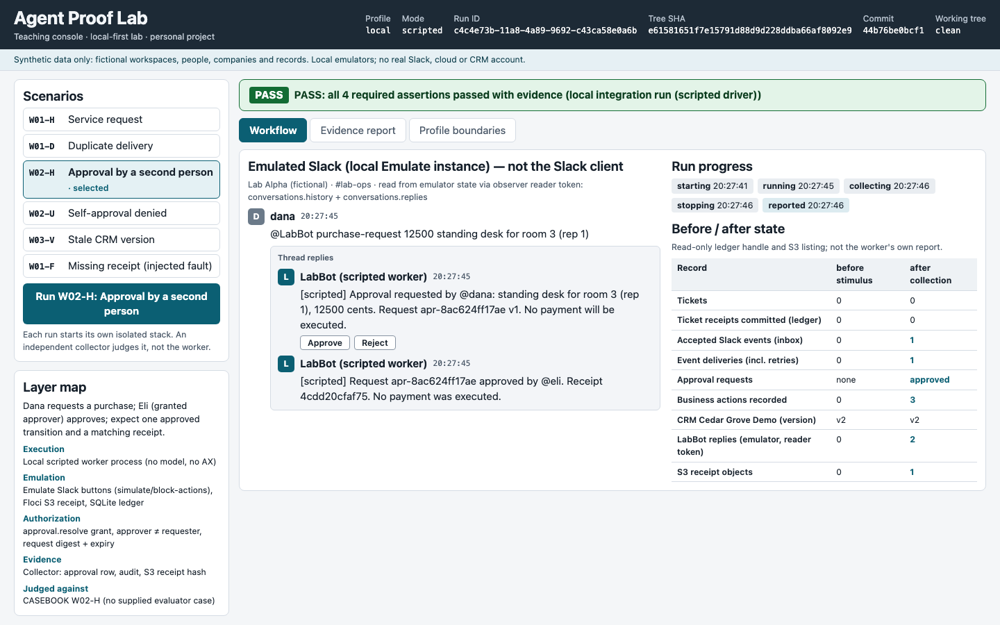
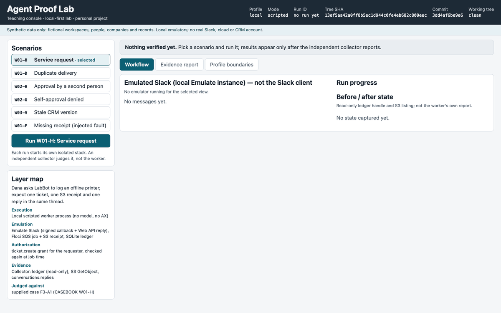
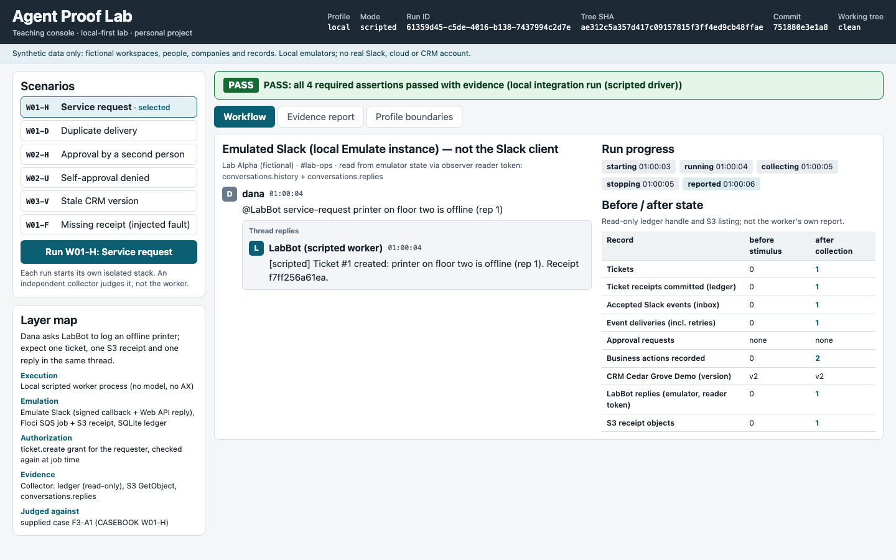
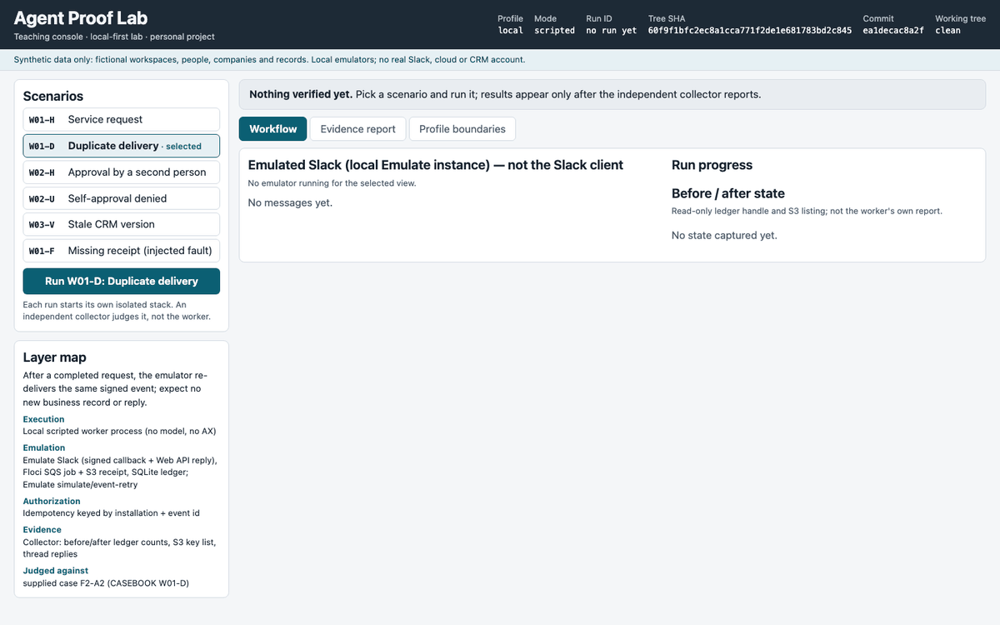
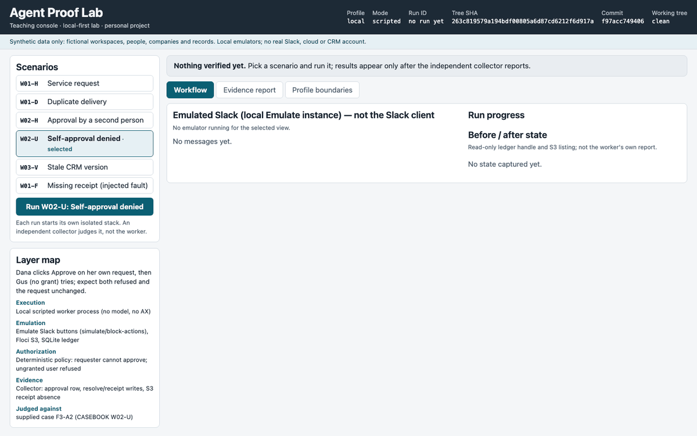
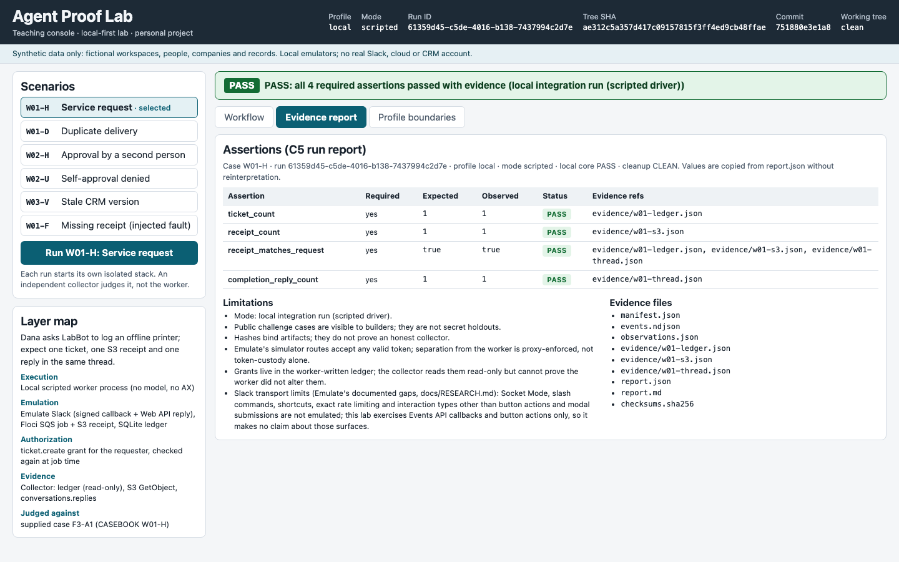
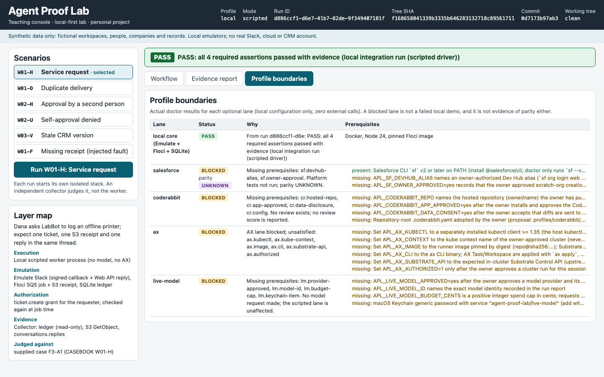
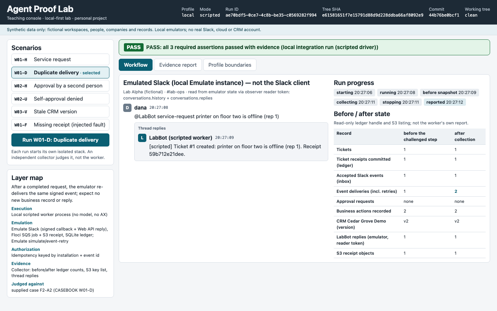
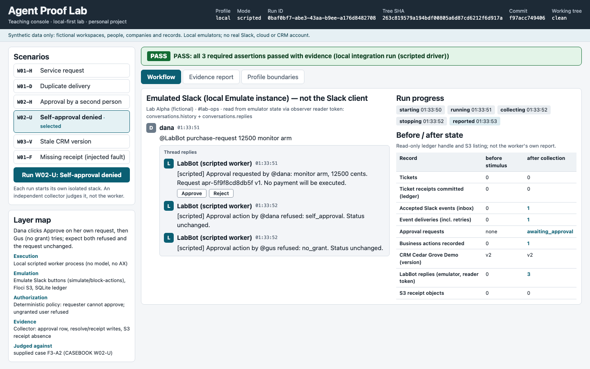
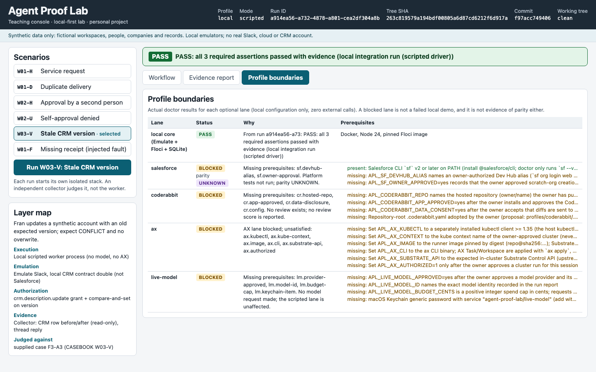

# Agent Proof Lab

> Independent personal project. It is not affiliated with or endorsed by Google, Slack, Salesforce, CodeRabbit, Vercel or the Floci project. Google AX (Agent Executor) and Agent Substrate are used only by an optional lane, and that lane's results are reported per assertion, failures included.

A local-first lab for testing Slack-led agent workflows against emulated Slack, local S3/SQS and a small ledger. It keeps four layers apart that a single green checkmark tends to blur: where the work runs (execution), what it talks to (emulation), what it is allowed to do (authorization) and what an independent collector can prove happened (evidence). A fifth question sits on top: what can honestly be claimed from that evidence.

Everything below runs on one laptop with fictional workspaces, people and records. No Slack workspace, cloud account, CRM org or model key is needed for the local core.

<!-- BEGIN LAB MEDIA: overview -->


The teaching console after a real local run of the approval workflow. Run `73f489dd` (W02-H, local profile, scripted mode, revision `f97acc7`): local core PASS, 4 of 4 required assertions passed; observed approval_status "approved", approved_transition_count 1, approval_receipt_count 1, approval_receipt_matches true. Synthetic data.
<!-- END LAB MEDIA: overview -->

> **Synthetic data only.** Every workspace, person, company and record in the screenshots is fictional and lives in local emulators. The console labels its transcript "Emulated Slack (local Emulate instance)": it is not the Slack client and has no Slack branding.

## See a workflow

A Slack mention reaches the scripted worker as a signed Events API callback. The worker queues a job in SQS, writes one ticket, stores a receipt object in S3 and replies in the original thread. A separate collector process then reads the emulator (reader token), S3 (its own credentials) and the ledger (read-only handle) and writes the C5 report that the console displays.

<!-- BEGIN LAB MEDIA: workflow -->


The local scripted worker processes a synthetic request; the evaluator checks the ticket, receipt and reply thread. Run `1326a187` (W01-H, local profile, scripted mode, revision `f97acc7`): local core PASS, 4 of 4 required assertions passed; observed ticket_count 1, receipt_count 1, receipt_matches_request true, completion_reply_count 1. Synthetic data.

[View the static result (PNG poster)](docs/assets/posters/slack-service-request.png)



A service request handled end to end: the reply is in the original thread and the collector found the ticket and the matching S3 receipt. Run `1326a187` (W01-H, local profile, scripted mode, revision `f97acc7`): local core PASS, 4 of 4 required assertions passed; observed ticket_count 1, receipt_count 1, receipt_matches_request true, completion_reply_count 1. Synthetic data.
<!-- END LAB MEDIA: workflow -->

## Understand the layers

This table and diagram describe the architecture; they are not execution evidence.

| Layer | Local core (always on) | Opt-in lane (off by default; each needs separate authorization) |
|---|---|---|
| Execution | Deterministic scripted worker process | AX runner on Agent Substrate; live-model planner with a spend cap |
| Emulation | Emulate Slack (signed callbacks, Web API, button simulations), Floci S3 + SQS, SQLite ledger, a narrow local CRM double | A real Salesforce scratch org |
| Authorization | Trusted identity from the event, deterministic policy, current grants, approval digest + expiry | Provider-side permissions in the real org |
| Evidence | Independent collector: reader token, own S3/SQS credentials, read-only SQLite; C5 report with hashes | CodeRabbit review lane (code review, not an outcome oracle) |

```text
What business outcome do we want?
  +-- Where does the work run?            local scripted worker (optional AX lane on a cluster)
  +-- What systems does it interact with?  Emulate Slack; Floci S3/SQS; local CRM double
  +-- Is the action allowed?              trusted identity + deterministic policy + current approval
  +-- Did it meet the requirement?        independent state assertions + public challenge cases
  +-- What can we honestly claim?         run-bound evidence + limitations
```

The longer explanation is in [the mental model](docs/MENTAL_MODEL.md).

## Try it

Tested on macOS 27 (arm64) with Node.js 24.22, npm 11.19 and Docker Desktop 29.9; other platforms are untested ([environment](docs/ENVIRONMENT.md)). You need Node.js 24 and Docker. FFmpeg 6 and Playwright's Chromium (`npx playwright install chromium`) are needed only for the console and media cases and for media capture. Export, media capture and F6-A2 also need a private-terms list you create yourself; without it they refuse to run (F6-A2 reports NOT_RUN). [Reproducing](docs/REPRODUCING.md#prerequisites) explains the list, the render review record and the optional pre-commit hook.

```bash
git clone https://github.com/shivanathd/google-ax-agent-proof-lab.git
cd google-ax-agent-proof-lab
npm ci                                   # also applies the pinned Emulate patch
docker pull floci/floci:2.3.0@sha256:e0b292df4dc9559b7b1bf4f51bdda4bb8e269276236438cd03cae661260ea8a9
npm run lab -- doctor                    # local prerequisites; optional lanes show SKIPPED (BLOCKED only if selected)
npm run lab -- up --profile local        # prints run_id and console_url (loopback only)
```

Open the printed `console_url`, pick a scenario and run it: each console run starts its own isolated stack and is judged by the independent collector. From another terminal you can also post a scripted stimulus into the `up` stack and then remove only that run's resources:

```bash
npm run lab -- run --run-id <run_id> --case W01-H
npm run lab -- down --run-id <run_id>    # cleanup_status CLEAN
```

To collect one supplied evaluator case end to end, or run all local gates:

```bash
npm run lab -- collect-case --case F3-A1 --output "$PWD/private-runs/manual/F3-A1.json"
bash docs/spec/active/2026-10-28-agent-proof-lab/evals/run-all.sh
```

The supplied harness's verdict is recorded per tree in the [claim ledger](docs/CLAIM_LEDGER.md) (harness run sets, with per-gate results), not in this README. `LOCAL_CORE_READY` needs every task, feature and challenge gate to pass, including F6-A3, which requires an independent render review record (`docs/assets/render-review.json`) whose hashes match the current README and media manifest. Run `run-all.sh` as above to reproduce it.

Salesforce, CodeRabbit and live-model lanes are optional and stay BLOCKED until their prerequisites and the owner's approval exist ([profiles](docs/PROFILES.md)). The AX lane was authorized and run on a GKE cluster under gVisor ([AX results](profiles/ax/RESULTS.md) §3.3, claims C-60 to C-69). Passed: W01-H as an AX task with independent collector evidence, a failing command's exit code 3 recorded while AX still showed `Running`, SIGTERM on worker eviction (from logs), resume after `ax suspend` keeping the workspace, sandbox isolation and router identity. Three assertions failed: `ax suspend` delivers no SIGTERM (C-62), `ax delete task` delivers none (C-63), and after a worker eviction followed by suspend and resume the result is lost (C-66).

## Watch the boundaries hold

Two challenges, each checked by the collector rather than by the worker's own reply. The duplicate case covers one bounded idempotency case (a signed retry of the same event), not "exactly once everywhere".

<!-- BEGIN LAB MEDIA: boundaries -->


Emulate re-delivers the same signed event; the collector compares before and after counts. Run `5b9cb5d9` (W01-D, local profile, scripted mode, revision `f97acc7`): local core PASS, 3 of 3 required assertions passed; observed additional_business_records 0, additional_completion_replies 0, same_request_identity true. Synthetic data.

[View the static result (PNG poster)](docs/assets/posters/duplicate-event-safe.png)



Dana tries to approve her own request and Gus, who has no grant, tries too; both clicks are refused. Run `0baf0bf7` (W02-U, local profile, scripted mode, revision `f97acc7`): local core PASS, 3 of 3 required assertions passed; observed approval_status "awaiting_approval", unauthorized_write_count 0, approval_receipt_count 0. Synthetic data.

[View the static result (PNG poster)](docs/assets/posters/approval-denied.png)


A self-approval and an ungranted approval click, both refused; the request record and receipts are unchanged. Run `0baf0bf7` (W02-U, local profile, scripted mode, revision `f97acc7`): local core PASS, 3 of 3 required assertions passed; observed approval_status "awaiting_approval", unauthorized_write_count 0, approval_receipt_count 0. Synthetic data.
<!-- END LAB MEDIA: boundaries -->

## Inspect the evidence

The console's evidence view is the C5 `report.json` as written: expected and observed values, status and the evidence file behind every assertion, plus the run's limitations. Sanitized exports of every run used on this page are committed in [docs/evidence](docs/evidence/README.md).

<!-- BEGIN LAB MEDIA: evidence -->


The evidence report is the C5 report.json shown as written: expected and observed values, status and evidence file per assertion, plus limitations. Run `1326a187` (W01-H, local profile, scripted mode, revision `f97acc7`): local core PASS, 4 of 4 required assertions passed; observed ticket_count 1, receipt_count 1, receipt_matches_request true, completion_reply_count 1. Synthetic data.
<!-- END LAB MEDIA: evidence -->

## Understand what remains unverified

<!-- BEGIN LAB MEDIA: profiles -->


Optional lanes as their doctors report them on this machine: blocked lanes are not failures of the local demo and are not evidence of provider parity. AX reads BLOCKED here because no cluster is configured locally; its authorized cluster runs are reported in profiles/ax/RESULTS.md. Run `1326a187` (W01-H, local profile, scripted mode, revision `f97acc7`): local core PASS, 4 of 4 required assertions passed; observed ticket_count 1, receipt_count 1, receipt_matches_request true, completion_reply_count 1. Synthetic data.
<!-- END LAB MEDIA: profiles -->

A local CRM double cannot show Salesforce behaviour, and a passing local run is not evidence of real Slack transport, cloud IAM or an unexecuted code review. Those lanes report BLOCKED with their missing prerequisites, and Salesforce parity stays UNKNOWN. The GitHub-rendered view of this README has not been checked (NOT_RUN) because nothing has been published.

## Short clips

<!-- BEGIN LAB MEDIA: videos -->
[](docs/assets/videos/mental-model.mp4)

Mental model: the reply is not the acceptance test (MP4 clip, 34 s, no audio; the captions are a separate WebVTT file, linked here, because a plain MP4 link does not load them). Shown in order (local profile, scripted mode, revision `f97acc7`): happy-path run `4f002b0a` (W01-H): local core PASS, 4 of 4 required assertions passed; then injected-fault run `67f7db3e` (W01-F): local core FAIL, 2 of 4 required assertions passed, not a success (failing: receipt_count 0, receipt_matches_request false). Injected fault: receipt object deleted from S3 by the test coordinator after the worker committed it (simulated fault). The poster is a frame of the first run. Synthetic data.

[Download the MP4](docs/assets/videos/mental-model.mp4) · [WebVTT captions (separate sidecar)](docs/assets/videos/mental-model.vtt) · [capture record](docs/assets/videos/mental-model.json)

[](docs/assets/videos/duplicate-delivery.mp4)

Duplicate delivery (MP4 clip, 16 s, no audio; the captions are a separate WebVTT file, linked here, because a plain MP4 link does not load them). Run `5b9cb5d9` (W01-D, local profile, scripted mode, revision `f97acc7`): local core PASS, 3 of 3 required assertions passed; observed additional_business_records 0, additional_completion_replies 0, same_request_identity true. Synthetic data.

[Download the MP4](docs/assets/videos/duplicate-delivery.mp4) · [WebVTT captions (separate sidecar)](docs/assets/videos/duplicate-delivery.vtt) · [capture record](docs/assets/videos/duplicate-delivery.json)

[](docs/assets/videos/permission-boundary.mp4)

Permission boundary (MP4 clip, 14 s, no audio; the captions are a separate WebVTT file, linked here, because a plain MP4 link does not load them). Run `0baf0bf7` (W02-U, local profile, scripted mode, revision `f97acc7`): local core PASS, 3 of 3 required assertions passed; observed approval_status "awaiting_approval", unauthorized_write_count 0, approval_receipt_count 0. Synthetic data.

[Download the MP4](docs/assets/videos/permission-boundary.mp4) · [WebVTT captions (separate sidecar)](docs/assets/videos/permission-boundary.vtt) · [capture record](docs/assets/videos/permission-boundary.json)

[](docs/assets/videos/emulator-vs-real-org.mp4)

Emulator versus real org (MP4 clip, 23 s, no audio; the captions are a separate WebVTT file, linked here, because a plain MP4 link does not load them). Run `a914ea56` (W03-V, local profile, scripted mode, revision `f97acc7`): local core PASS, 3 of 3 required assertions passed; observed result "CONFLICT", description_unchanged true, write_count 0. Synthetic data.

[Download the MP4](docs/assets/videos/emulator-vs-real-org.mp4) · [WebVTT captions (separate sidecar)](docs/assets/videos/emulator-vs-real-org.vtt) · [capture record](docs/assets/videos/emulator-vs-real-org.json)

Inline playback on GitHub needs a post-publication upload of these clips; until that is approved the links above open the MP4 files from the repository.
<!-- END LAB MEDIA: videos -->

## Explore and reproduce

- [Use-case casebook](docs/CASEBOOK.md) and [public challenge scenarios](docs/spec/active/2026-10-28-agent-proof-lab/SCENARIOS.md)
- [Reproducing the media and evidence](docs/REPRODUCING.md) and [recordings](recordings/README.md)
- [Recording runbook](docs/RECORDING_RUNBOOK.md), [README media contract](docs/README_MEDIA_SPEC.md), [storyboard](docs/README_STORYBOARD.md)
- [Learnings: expected vs observed](docs/LEARNINGS.md) and [research register](docs/RESEARCH.md)
- [Article draft (unreviewed)](writing/ARTICLE_DRAFT.md)
- [Build specification](docs/spec/active/2026-10-28-agent-proof-lab/REQUIREMENTS.md), [implementation plan](docs/spec/active/2026-10-28-agent-proof-lab/IMPLEMENTATION_PLAN.md), [decisions](docs/spec/active/2026-10-28-agent-proof-lab/DECISIONS.md) and the [supplied evaluator](docs/spec/active/2026-10-28-agent-proof-lab/evals/README.md)
- [Publication checklist](docs/PUBLICATION_CHECKLIST.md)

This is a personal educational project, released under the [MIT License](LICENSE); third-party notices are in [NOTICE](NOTICE). Repository publication, provider-app installation and any upload need separate approval.
