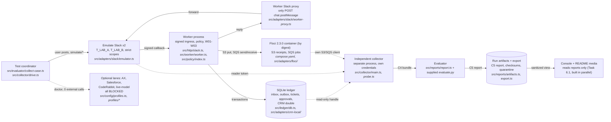
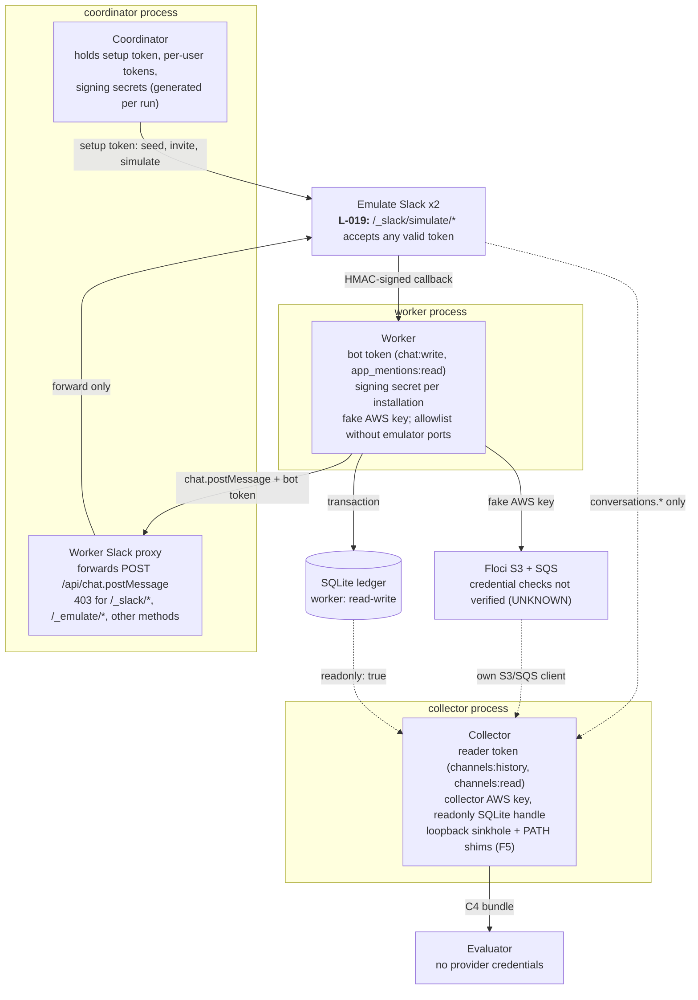
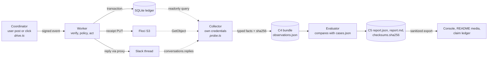
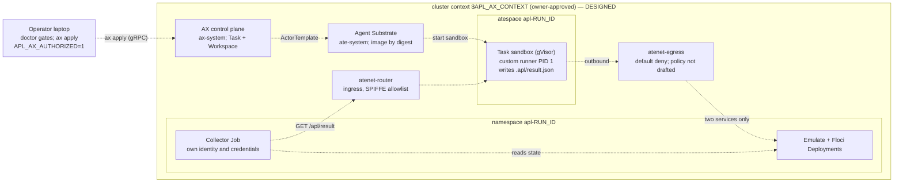

# Architecture diagrams

**These are architecture, not execution evidence.** A box or an arrow here says how the code is built, not that a case passed. Run results live in `artifacts/runs/<run_id>/` and are cited by run ID in [`../CLAIM_LEDGER.md`](../CLAIM_LEDGER.md).

Each diagram exists twice:

- a Mermaid block below, which GitHub renders inline;
- an interactive HTML view generated with Archify from the JSON in [`src/`](src/) (`system-map.html`, `trust-boundaries.html`, `evidence-flow.html`, `ax-lane.html`). Download and open it locally; GitHub shows HTML as source. Automated layout and browser checks passed for all four; they have not been visually reviewed by a person.

Drawn from the tree at commit `be3bb2d` (2026-10-28). If the code changes, these change with it: every box names the file that implements it.

## (a) System map



The coordinator starts the stack (`startRun` in `src/config/lifecycle.ts`), spawns the worker and the collector as separate Node processes, drives the scripted stimulus and asks the collector to observe. The worker never talks to the collector, and the collector never writes business state. Not drawn: the fault-injecting loopback proxy (`src/adapters/faults/proxy.ts`) used by W01-S and W01-T.

## (b) Trust boundaries and credential custody



What enforces each boundary, with the file that does it:

| Boundary | Enforced by | Source |
|---|---|---|
| Worker receives only its bot token and signing secret | `workerConfig` builds the worker's whole env from one JSON value; ambient credential variables are stripped | `src/worker/config.ts`, `src/config/env.ts` |
| Worker cannot reach `/_slack/simulate/*` | The worker is given the proxy URL, never an emulator URL, and emulator ports are removed from its allowlist | `src/config/lifecycle.ts` (`startWorker`), `src/adapters/slack/worker-proxy.ts` |
| Collector cannot write Slack | Its token carries only `channels:history`, `channels:read` under `strict_scopes` | `src/adapters/slack/emulator.ts` (`SCOPES.reader`) |
| Collector cannot write the ledger | `better-sqlite3` opened with `{ readonly: true }` (L-015) | `src/ledger/read.ts` |
| Evaluator cannot see stimulus internals | It reads only the bundle and the spec's `cases.json` | `src/reports/artifacts.ts` |

**Residual (L-019).** Emulate checks only that a token is valid on its simulator routes. Anyone who knows an emulator URL and holds any valid token for that workspace can simulate clicks and retries. The boundary is process separation (the worker never learns the URL), not emulator authorization. **Unknown.** The worker and collector use different Floci keys, but nobody has checked that Floci rejects a wrong key, so treat the separation as labelling.

## (c) Evidence flow



Rules the flow depends on, each in code:

1. A fact exists only if every capture it depends on succeeded (`Probe.fact` in `src/collector/probe.ts`). A failed capture leaves the key absent with a reason, so the evaluator reports UNKNOWN, not 0 (G-UNKNOWN).
2. The bundle binds to `tree_sha`, `candidate_revision`, `dirty` and `patch_sha256` (ADR-9). Untracked files make `dirty` true but are not in `patch_sha256` (L-024).
3. `generateReport` refuses to regenerate a report when captured files fail their recorded checksums (`src/reports/artifacts.ts`, L-022).
4. `exportRun` scans the allowlisted projection for secret-shaped strings and private terms and quarantines the run on any match (`src/reports/export.ts`, G-EXPORT).

## (d) Optional AX lane: DESIGNED, not executed



Every dashed arrow is a design from `profiles/ax/README.md`, never run. What has run is local only: the doctor and run gates (zero external calls when blocked) and the custom runner image under plain Docker (`runc`, amd64 emulation), in `tests/integration/ax-profile.test.ts`. A local runner pass says nothing about gVisor (L-012). AX does not read the command's exit status back (L-006), so the collector, not the task phase, would decide PASS or FAIL.

## Regenerating the HTML views

```bash
node <archify>/bin/archify.mjs finalize architecture docs/diagrams/src/system-map.architecture.json docs/diagrams/system-map.html --quality showcase --json
node <archify>/bin/archify.mjs finalize architecture docs/diagrams/src/trust-boundaries.architecture.json docs/diagrams/trust-boundaries.html --quality showcase --json
node <archify>/bin/archify.mjs finalize dataflow docs/diagrams/src/evidence-flow.dataflow.json docs/diagrams/evidence-flow.html --quality showcase --json
node <archify>/bin/archify.mjs finalize architecture docs/diagrams/src/ax-lane.architecture.json docs/diagrams/ax-lane.html --quality showcase --json
```

The JSON carries no `meta.repository` source links: Archify requires an `origin` remote to verify them, and this repository has none until publication. File citations are in the node labels above and in the cards.
