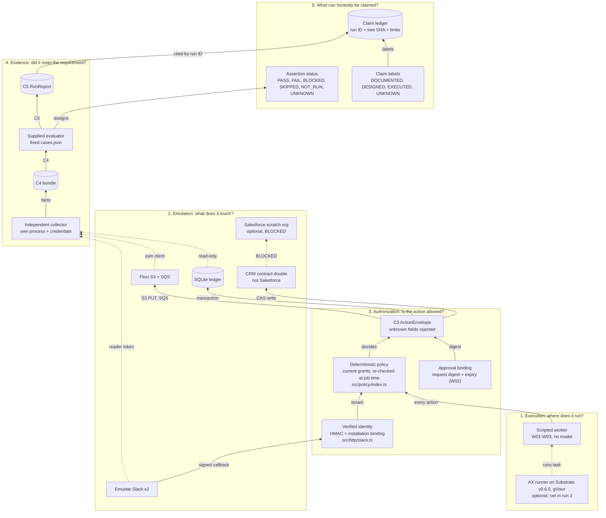
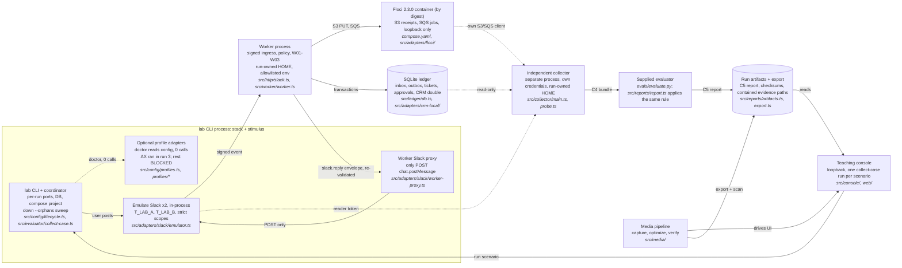
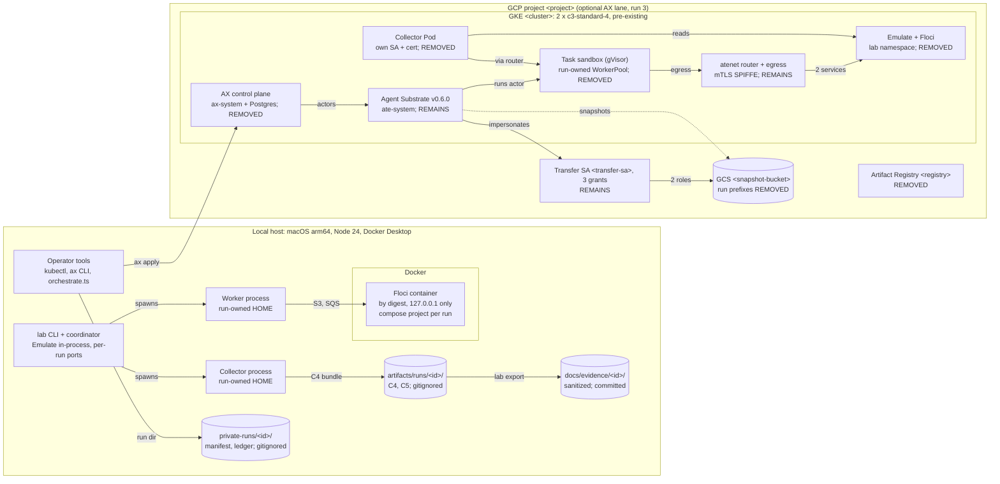
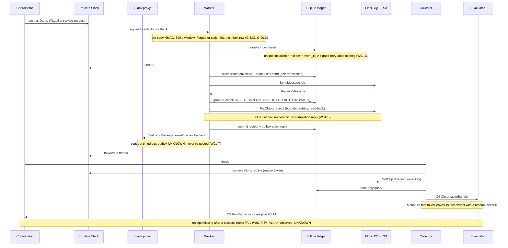
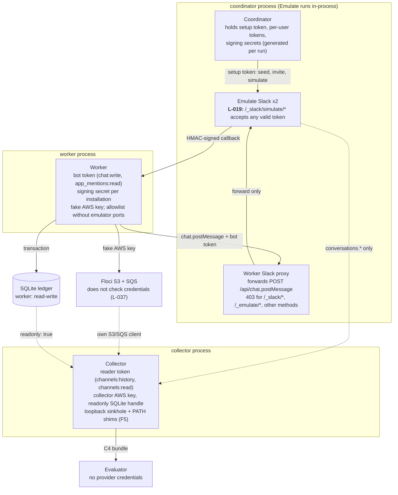
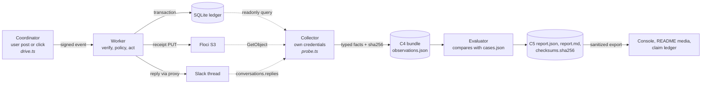
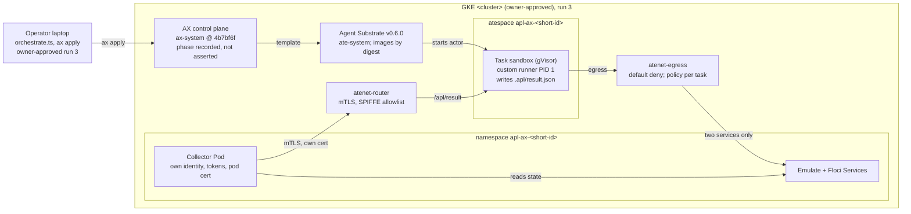

# Architecture diagrams

**These are architecture, not execution evidence.** A box or an arrow here says how the code is built, not that a case passed. Run results live in `artifacts/runs/<run_id>/` and are cited by run ID in [`../CLAIM_LEDGER.md`](../CLAIM_LEDGER.md). The one exception in kind is the AX lane, whose diagrams show what was deployed for run 3; its results are in [`../../profiles/ax/RESULTS.md`](../../profiles/ax/RESULTS.md), not in the drawing.

## Index

Each diagram exists twice: a Mermaid block below, which GitHub renders inline, and an interactive HTML view generated with Archify from the JSON in [`src/`](src/). GitHub shows the HTML as source, so download it and open it locally.

| HTML view | Archify type | What it answers |
|---|---|---|
| [`mental-model.html`](mental-model.html) | architecture | The four layers (execution, emulation, authorization, evidence) kept apart, and the fifth question: what can honestly be claimed. |
| [`system-map.html`](system-map.html) | architecture | Every runtime part of the local lab and what talks to what. |
| [`infra-layers.html`](infra-layers.html) | architecture | Where it runs: the local host, and the optional GKE lane as deployed in run 3, with what teardown removed and what remains. |
| [`request-flow.html`](request-flow.html) | sequence | How one W01 service request travels from a Slack mention to a C5 report, with its failure branches. |
| [`trust-boundaries.html`](trust-boundaries.html) | architecture | Which process holds which credential, and what enforces each boundary. |
| [`evidence-flow.html`](evidence-flow.html) | dataflow | How a stimulus becomes a fact, a report and a published claim. |
| [`ax-lane.html`](ax-lane.html) | architecture | The optional AX lane on Agent Substrate as executed in run 3, with its per-assertion results. |

Automated Archify checks (schema, layout, provenance and a real-browser check) passed for all seven. An agent inspected light-theme captures of the five redrawn on 2026-10-29; no person has reviewed any of them.

Drawn from the tree at commit `872e83a` (2026-10-29). If the code changes, these change with it: every box names the file that implements it, here or in the HTML cards.

## (a) Mental model: four layers and the fifth question



Each layer answers one question; a green result in one says nothing about another. Every effect, `slack.reply` included, is a C3 envelope that deterministic policy decided (`src/workflows/context.ts`). A worker's "done" reply is one observation for the collector, not the verdict. Sources: [`../MENTAL_MODEL.md`](../MENTAL_MODEL.md), [`CONTRACTS.md`](../spec/active/2026-10-28-agent-proof-lab/contracts/CONTRACTS.md) (C2 to C5), the README section "Understand the layers".

## (b) System map



The coordinator starts the stack (`startRun` in `src/config/lifecycle.ts`), spawns the worker and the collector as separate Node processes with run-owned HOME directories (`src/worker/config.ts`, `collectorEnv` in `src/evaluator/collect-case.ts`), drives the scripted stimulus and asks the collector to observe. The worker never talks to the collector, and the collector never writes business state. Changed since the first map: replies are C3 `slack.reply` envelopes stored in the outbox and re-validated before the proxy send (`publish` in `src/worker/worker.ts`); evidence paths must resolve inside the run's artifact directory, so a symlink cannot escape (`containedPath` in `src/reports/report.ts`); `lab down --orphans` removes only containers of runs that are no longer active (`removeOrphans`). Not drawn: the fault-injecting loopback proxy (`src/adapters/faults/proxy.ts`) used by W01-S and W01-T.

## (c) Infrastructure layers



The local lane binds every port to loopback (`compose.yaml`, `src/config/endpoints.ts`) and gives each run its own ports, ledger file and compose project (`src/config/lifecycle.ts`). The GKE lane is drawn as deployed in run 3 ([`profiles/ax/README.md`](../../profiles/ax/README.md), in-cluster placement); identifiers are placeholders. After the owner-approved teardown on 2026-10-29 the lab namespace, `ax-system` with its PersistentVolume and disk, the registry and the run's snapshot prefixes are gone; Substrate v0.6.0 and the transfer service account with its three grants remain on purpose, because the v0.6.0 API server needs them ([`RESULTS.md`](../../profiles/ax/RESULTS.md), Teardown). The cluster and the bucket existed before the run.

## (d) How it works: one W01 request



Sources: `src/http/slack.ts`, `src/adapters/slack/signature.ts`, `src/ledger/db.ts` (`acceptEvent`), `src/workflows/w01.ts`, `src/workflows/context.ts`, `src/worker/worker.ts`, `src/collector/probe.ts` (`captureTicket`), `src/evaluator/collect-case.ts`, `src/reports/report.ts`, [`../CASEBOOK.md`](../CASEBOOK.md) W01. The branches are exercised by `tests/integration/slack.test.ts` and `tests/integration/workflows.test.ts`; which runs passed is in the claim ledger (C-03 to C-05, C-08).

## (e) Trust boundaries and credential custody



What enforces each boundary, with the file that does it:

| Boundary | Enforced by | Source |
|---|---|---|
| Worker receives only its bot token and signing secret | `workerConfig` builds the worker's whole env from one JSON value; ambient credential variables are stripped | `src/worker/config.ts`, `src/config/env.ts` |
| Worker cannot reach `/_slack/simulate/*` | The worker is given the proxy URL, never an emulator URL, and emulator ports are removed from its allowlist | `src/config/lifecycle.ts` (`startWorker`), `src/adapters/slack/worker-proxy.ts` |
| Collector cannot write Slack | Its token carries only `channels:history`, `channels:read` under `strict_scopes` | `src/adapters/slack/emulator.ts` (`SCOPES.reader`) |
| Collector cannot write the ledger | `better-sqlite3` opened with `{ readonly: true }` (L-015) | `src/ledger/read.ts` |
| Evaluator cannot see stimulus internals | It reads only the bundle and the spec's `cases.json` | `src/reports/artifacts.ts` |

**Residual (L-019).** Emulate checks only that a token is valid on its simulator routes. Anyone who knows an emulator URL and holds any valid token for that workspace can simulate clicks and retries. The boundary is process separation (the worker never learns the URL), not emulator authorization. **Also labelling only (L-037).** The worker and collector use different Floci keys, but Floci served the worker's receipts to the collector's never-provisioned key: it does not check credentials. The boundary is process separation here too.

**Corrected on 2026-10-29.** Earlier versions drew Emulate outside the coordinator process. It runs inside it: `startWorkspace` calls `createEmulator` in the process that runs `startRun` (`src/adapters/slack/emulator.ts`, `src/config/lifecycle.ts`). The HTML view and the block above now place it there.

## (f) Evidence flow



Rules the flow depends on, each in code:

1. A fact exists only if every capture it depends on succeeded (`Probe.fact` in `src/collector/probe.ts`). A failed capture leaves the key absent with a reason, so the evaluator reports UNKNOWN, not 0 (G-UNKNOWN).
2. The bundle binds to `tree_sha`, `candidate_revision`, `dirty` and `patch_sha256` (ADR-9). Untracked files make `dirty` true but are not in `patch_sha256` (L-024).
3. `generateReport` refuses to regenerate a report when captured files fail their recorded checksums, or when an evidence path resolves outside the artifact directory (`src/reports/artifacts.ts`, L-022).
4. `exportRun` scans the allowlisted projection for secret-shaped strings and private terms and quarantines the run on any match (`src/reports/export.ts`, G-EXPORT).

## (g) Optional AX lane, as executed in run 3



Run 3 (2026-10-28) ran every test on the cluster under gVisor. Per assertion ([`RESULTS.md`](../../profiles/ax/RESULTS.md) section 3.3):

- **PASS (6):** F3-A1 (W01-H) as an AX Task with the local lane's assertions; AX-R1 failing command; SIGTERM on worker eviction (logs only); resume after `ax suspend` keeps the prepare-once marker and the workspace; isolation from inside the sandbox; router identity.
- **FAIL (3):** `ax suspend` delivers no SIGTERM; `ax delete task` delivers no SIGTERM; after eviction, then suspend and resume, the result and the marker are lost (L-048).
- **Neither:** secrets in `ax get task` observed (L-034); timing expectation met.

The task phase is not the outcome (L-006): AX reported `Running` while the failing command had exited 3, and `cases.ax.json` records `ax_task_phase` without asserting it. The collector, not the task phase, decides PASS or FAIL. The lane was torn down on 2026-10-29; diagram (c) shows what remains.

## Regenerating the HTML views

```bash
node <archify>/bin/archify.mjs finalize architecture docs/diagrams/src/mental-model.architecture.json docs/diagrams/mental-model.html --repo-root . --quality showcase --json
node <archify>/bin/archify.mjs finalize architecture docs/diagrams/src/system-map.architecture.json docs/diagrams/system-map.html --repo-root . --quality showcase --json
node <archify>/bin/archify.mjs finalize architecture docs/diagrams/src/infra-layers.architecture.json docs/diagrams/infra-layers.html --repo-root . --quality showcase --json
node <archify>/bin/archify.mjs finalize sequence docs/diagrams/src/request-flow.sequence.json docs/diagrams/request-flow.html --repo-root . --quality showcase --json
node <archify>/bin/archify.mjs finalize architecture docs/diagrams/src/trust-boundaries.architecture.json docs/diagrams/trust-boundaries.html --repo-root . --quality showcase --json
node <archify>/bin/archify.mjs finalize dataflow docs/diagrams/src/evidence-flow.dataflow.json docs/diagrams/evidence-flow.html --quality showcase --json
node <archify>/bin/archify.mjs finalize architecture docs/diagrams/src/ax-lane.architecture.json docs/diagrams/ax-lane.html --repo-root . --quality showcase --json
```

`finalize` also writes receipt JSON files next to each HTML; they are not committed. The JSON carries no `meta.repository` source links: Archify requires an `origin` remote to verify them, and this repository has none until publication. File citations are in the node labels above and in the HTML cards.
